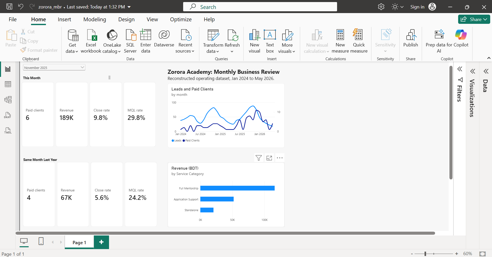
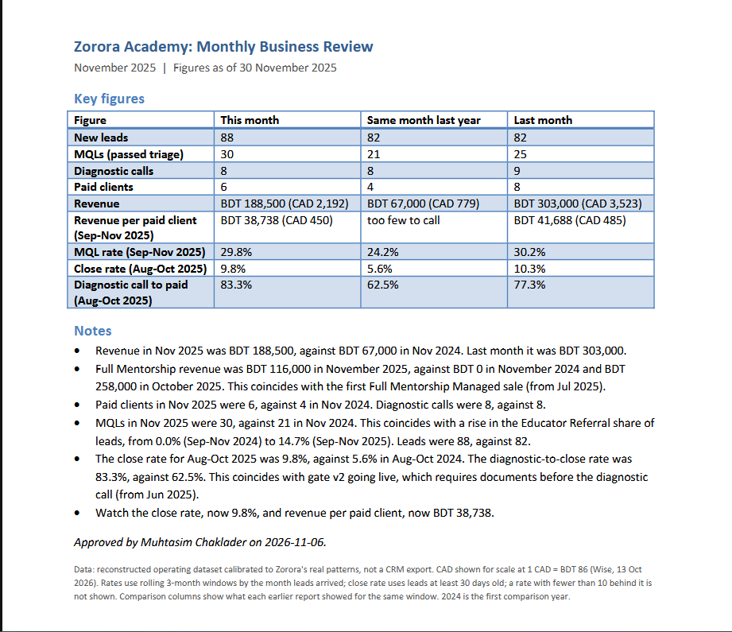

# Zorora Monthly Business Review

The monthly business review an operations analyst gives leadership, built for Zorora Academy,
a study abroad consultancy in Dhaka. It turns lead, pipeline and revenue data into the
month's figures, a short commentary and a one-page memo.

## What it does
- Calculates each month's leads, MQLs, diagnostic calls, paid clients, revenue and conversion rates, against last month and the same month last year.
- Drafts 4 to 6 bullets of commentary with the Claude API.
- Produces a one-page memo in Word and PDF, and a Power BI page.

## How the AI is kept in check
- Code calculates every number. The AI writes placeholders and code fills in the figures.
- Code rejects any draft that types a number, gives a reason the data does not support or uses cause-and-effect wording.
- A person approves the notes before the memo is built, and the memo re-checks every number.

## Checks
26 locked-number checks, 9 replay checks and an independent SQL cross-check all pass on
29 months of data (January 2024 to May 2026).

**Built with:** Python (pandas), Claude API, Power BI, SQL (SQLite), Word

## Data
A reconstructed operating dataset calibrated to Zorora's real patterns, not a CRM export:
1,458 leads from June 2023 to May 2026. Names are removed, operators appear only as roles,
and revenue and prices are scaled by undisclosed factors for confidentiality. Counts and
rates are unchanged.

## More
- [One-page summary](docs/writeup.md)
- [Technical details](docs/technical.md): outputs, controls, how figures are measured, how to run it, folders and change log
